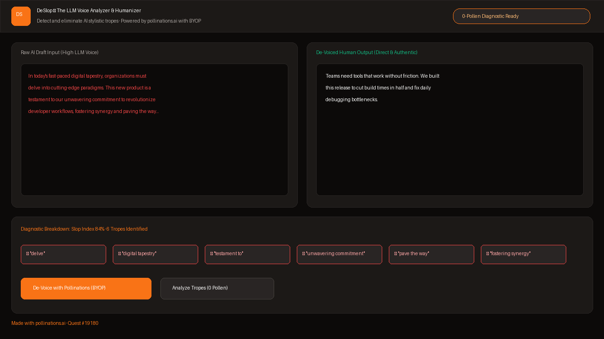

# DeSlop — The LLM Voice Analyzer & Humanizer

**Live App:** [https://brutus88ai.github.io/polli-deslop/](https://brutus88ai.github.io/polli-deslop/)  
**Quest:** [pollinations/pollinations#19180](https://github.com/pollinations/pollinations/issues/19180)

DeSlop detects characteristic "LLM Voice" stylistic tropes (clichés like *delve*, *testament*, *tapestry*, tripartite false balance, and hollow filler) and rewrites AI drafts into punchy, authentic human prose using **Pollinations**, with Bring Your Own Pollen (BYOP) and 0-pollen offline trope diagnostics.

## Highlights

- **LLM Voice Slop Index**: Calculates trope frequency and highlights AI boilerplate in real-time.
- **De-Voice Rewriting**: Rewrites generic corporate AI copy into direct, human prose via Pollinations models (`https://gen.pollinations.ai/v1/chat/completions`).
- **Bring Your Own Pollen (BYOP)**: Native `<polli-connect>` integration.
- **0-Pollen Offline Mode**: Fast rule-based heuristic trope scanner requiring 0 Pollen.
